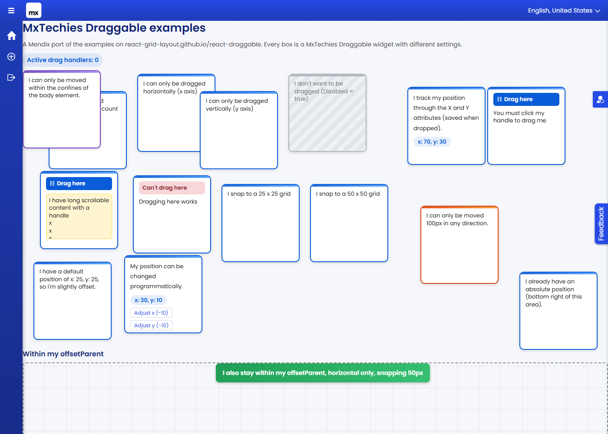
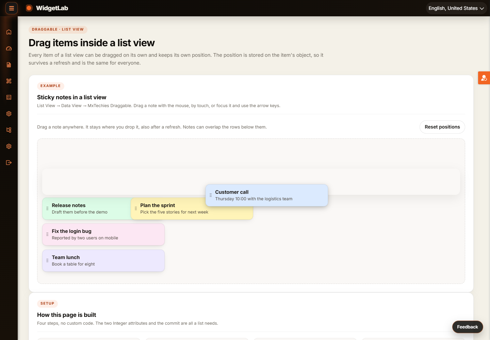

# MxTechiesDraggableDemo

An example Mendix module (`MxTechiesDraggableDemo`) showing how to use the
[MxTechies Draggable](https://github.com/bharathidas/MxTechiesDraggable) widget (2.0.0).
It ports every box from the [react-draggable demo page](https://react-grid-layout.github.io/react-draggable/)
to a Mendix page, adds the 2.0 examples (canvas, sortable lists and kanban, photo grid, saved layouts), and has a
separate page that drags items inside a **list view**.



## New in 2.0: dragging inside a list view

Page `Draggable_ListView` (`/p/draggable-list-view`, menu item "Draggable in a list view") is built as
**List View → Data View → MxTechies Draggable**. Every sticky note can be dragged on its own and keeps its own position,
also after a refresh.



How it is set up, no custom code:

1. **Entity** `ListNote` with two Integer attributes, `PosX` and `PosY` (plus Title, Detail, Color, SortOrder).
2. **List View** over `ListNote`, sorted on `SortOrder`, with **Editable** on. A data view inside a list view that is not
   editable is read-only, and the widget then reports "This change could not be saved, so it was undone."
3. **Data View** in the list item, with the list view's object as its data source.
4. **MxTechies Draggable** in the data view: **X attribute** `PosX`, **Y attribute** `PosY`, **On drag stop**
   `ACT_ListDemo_SavePosition` (commits the note), **Bounds** None, **Raise list rows** on (the default), so the
   dragged note is drawn above the rows below it.

`ACT_ListDemo_Reset` (the Reset positions button) puts every note back in its place. The example notes are created
by `DS_ListDemo_Board` the first time the page opens.

## What is in the module

| Document | Purpose |
| --- | --- |
| `Draggable_Test` (page) | 17 draggable boxes, one per react-draggable demo case, plus the 2.0 examples |
| `Draggable_ListView` (page) | Sticky notes in a list view, each with its own position |
| `DraggableDemo` (entity) | Holds `ActiveDrags`, `TrackX`, `TrackY`, `PosX`, `PosY` and more for the live examples |
| `CanvasItem`, `BoardLayout`, `TaskCard`, `PhotoTile` (entities) | Canvas, saved layouts, sortable kanban lists and the photo grid |
| `ListBoard`, `ListNote` (entities) | The list view example |
| `DS_DraggableDemo_Create`, `ACT_DraggableDemo_*` | Demo object, programmatic moves and drag counters |
| `SUB_Drag2_SeedData`, `ACT_Drag2_*`, `DS_Drag2_Board` | Seed data and actions of the 2.0 examples on `Draggable_Test` |
| `DS_ListDemo_Board`, `SUB_ListDemo_Seed`, `ACT_ListDemo_SavePosition`, `ACT_ListDemo_Reset` | The list view example |
| `themesource/mxtechiesdraggabledemo/web/main.scss` | Styling for the boxes, handles, arena, notes and drag states |

## Installation

1. Import `releases/MxTechiesDraggableDemo.mpk` through **App > Import module package** in Studio Pro. The MxTechies
   Draggable 2.0.0 widget comes with it; keep a newer version if your `widgets` folder already has one.
2. Add the pages `Draggable_Test` and `Draggable_ListView` to your navigation.
3. Give the module role **User** to the user roles that should see the pages and run the app. The example data is
   created the first time a page opens.

The module needs only Atlas Core (`Atlas_Core.Atlas_Default`).

## Test

`test/test-examples.mjs` drives a real Chrome against a running app with puppeteer-core and checks the examples on
`Draggable_Test`. It expects a menu item named "Draggable test" and signs in with `MX_USER` / `MX_PASS` (defaults
`MxAdmin` / `1`). `test/test-list-view.mjs` checks the list view page: notes drawn above the rows below while dragged
and after the drop, each note keeping its own position after a reload, untouched notes staying in place.

```
npm init -y && npm install puppeteer-core
MX_USER=MxAdmin MX_PASS=yourpassword node test/test-examples.mjs
MX_USER=MxAdmin MX_PASS=yourpassword node test/test-list-view.mjs
```

## License

Apache-2.0
