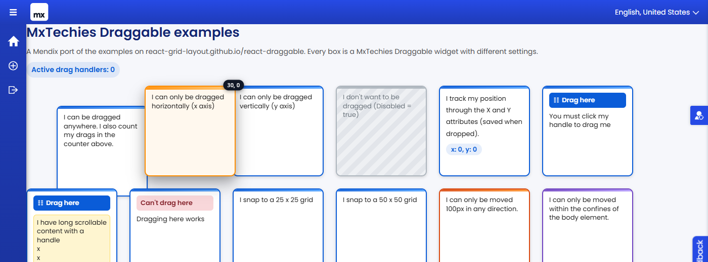

# MxTechiesDraggableDemo

An example Mendix module (`MxTechiesDraggableDemo`) showing how to use the
[MxTechies Draggable](https://github.com/bharathidas/MxTechiesDraggable) widget.
It ports every box from the [react-draggable demo page](https://react-grid-layout.github.io/react-draggable/)
to a Mendix page, so you can open one page and see each setting in action.


## What is in the module

| Document | Purpose |
| --- | --- |
| `Draggable_Test` (page) | 17 draggable boxes, one per demo case, plus a bounded arena |
| `DraggableDemo` (entity, non-persistable) | Holds `ActiveDrags`, `TrackX`, `TrackY`, `PosX`, `PosY` for the live examples |
| `DS_DraggableDemo_Create` | Data source microflow that creates the demo object |
| `ACT_DraggableDemo_AdjustX` / `AdjustY` | Move the "programmatic" box by changing its attributes |
| `ACT_DraggableDemo_DragStart` / `DragStop` | Count active drags through the widget's events |
| `themesource/mxtechiesdraggabledemo/web/main.scss` | Styling for the boxes, handles, arena and drag states |

## Examples on the page

- Dragged anywhere, with an active drag counter driven by On drag start / On drag stop
- Horizontal only, vertical only, disabled
- Position tracking through X and Y attributes, saved on drop
- Drag handle, handle with scrollable content, cancel zone
- 25px and 50px grid snapping
- Limited to 100px in any direction ("Distance from start" bounds)
- Kept inside the body element
- Default position 25 / 25
- Position changed programmatically from microflow buttons
- Absolutely positioned box
- Two boxes kept inside their parent, one of them axis-locked and snapping



## Installation

1. Install the MxTechies Draggable widget (Marketplace or the `.mpk` from its releases page).
2. Import `releases/MxTechiesDraggableDemo.mpk` through **App > Import module package** in Studio Pro.
3. Add the `Draggable_Test` page to your navigation, or set it as a home page.
4. Give the module role **User** to the user roles that should see the page and run the app.

The entity is non-persistable, so no database changes are needed.

## Test

`test/test-examples.mjs` drives a real Chrome against a running app with puppeteer-core and checks all
examples (axis locks, bounds, grid, handle, cancel, attributes, microflow buttons, badge). It expects a menu
item named "Draggable test" and signs in with `MX_USER` / `MX_PASS` (defaults `MxAdmin` / `1`).

```
npm init -y && npm install puppeteer-core
MX_USER=MxAdmin MX_PASS=yourpassword node test/test-examples.mjs
```

## License

Apache-2.0
